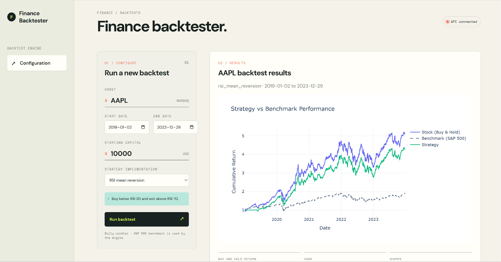

# Finance Backtester

A modular Python backtesting platform with a FastAPI service and a lightweight browser frontend. It downloads historical market data, applies configurable trading strategies, and returns performance metrics and portfolio data through a documented HTTP API.

## Highlights

- Clean separation between market data loading, strategy execution, backtesting, metrics, and presentation.
- Pydantic validation for API requests, strategy definitions, dates, symbols, and capital.
- Historical data loaded through `yfinance`, normalized into validated OHLCV data, and aligned with an S&P 500 benchmark.
- Strategy presets for price momentum, RSI mean reversion, SMA trend following, and EMA momentum.
- Performance metrics including buy-and-hold return, CAGR, Sharpe and Sortino ratios, maximum drawdown, alpha, beta, and Calmar ratio.
- Interactive Plotly performance chart comparing the stock, S&P 500 benchmark, and strategy cumulative returns.
- FastAPI endpoints with CORS support for the static frontend.
- Automated test coverage for the API contract, strategy presets, engine, indicators, and backtest behavior.

## Architecture

```text
yfinance
	|
	v
DataLoader -> validated OHLCV DataFrame
	|
	v
Strategy / StrategyExecutor -> position signals
	|
	v
Backtest -> portfolio values, metrics, and performance chart
	|
	+-> FastAPI -> browser frontend
```

The core engine is independent of the web layer. A `BacktestConfig` describes a run, while `Backtest` performs the calculation and returns a `BacktestResult`, including a Plotly `performance_chart`. The API serializes the chart's Plotly data and layout to JSON for the frontend, which renders it with Plotly.js.

## Strategies

The frontend loads the available strategies from the backend at runtime:

| ID | Strategy | Logic |
| --- | --- | --- |
| `mock` | Mockstrategy | Example two-day price momentum strategy |
| `rsi_mean_reversion` | RSI mean reversion | Enters below RSI 30 and exits above RSI 70, with risk limits |
| `sma_trend` | SMA trend | Enters while price is above the 200-day SMA |
| `ema_momentum` | EMA momentum | Enters while price is above the 20-day EMA, with a stop loss |

Strategies using indicator conditions are validated by `StrategySchema` and executed by `StrategyExecutor`. This makes it possible to add new presets without changing the API or frontend contract.

## API

Start a backtest with `POST /api/backtests`:

```json
{
  "symbol": "AAPL",
  "start_date": "2019-01-01",
  "end_date": "2024-01-01",
  "cash": 10000,
  "strategy": "rsi_mean_reversion"
}
```

Available strategies are returned by `GET /api/backtests/strategies`. A health check is available at `GET /health`, and interactive API documentation is served at `/docs`.

The backtest response includes:

- The normalized symbol, selected strategy, and date range
- Calculated metrics
- Daily dates and adjusted closing prices
- Daily portfolio values
- A `performance_chart` object with Plotly `data` and `layout` for rendering the stock, benchmark, and strategy cumulative returns

The static frontend displays this chart after a successful backtest. It uses Plotly.js from the Plotly CDN, so the browser needs access to that CDN.

## Run Locally

The project requires Python 3.11 or newer. From the repository root:

```bash
python3 -m venv .venv
source .venv/bin/activate
pip install -r requirements.txt
pip install -e .
start-app
```

Open the frontend at [http://localhost:4173](http://localhost:4173). The API documentation is at [http://localhost:8000/docs](http://localhost:8000/docs).

The `start-app` command launches both the FastAPI server and the static frontend. Press `Ctrl+C` to stop both processes.

## Test

```bash
python -m pytest -q
```

The test suite covers API request validation and response serialization, data models and loading, indicator calculations, strategy execution, backtest portfolio behavior, chart output, and metrics. The current suite contains 56 passing tests.

## Project Structure

```text
api/                  FastAPI application, schemas, and routes
cli/                  Application launcher
engine/               Backtest engine and strategy abstractions
engine/data/          Market data loading and validation
engine/strategy/      Strategy schemas, executor, and presets
indicators/           Technical indicator calculations
frontend/             Static browser interface
tests/                Automated tests by subsystem
```

## Screenshots


## Scope and Next Steps

The current implementation is intentionally focused on a reliable single-run workflow. Natural next steps include persisted backtest history, transaction costs and slippage, richer chart serialization, asynchronous job execution for long data ranges, and HTTP-level API integration tests.